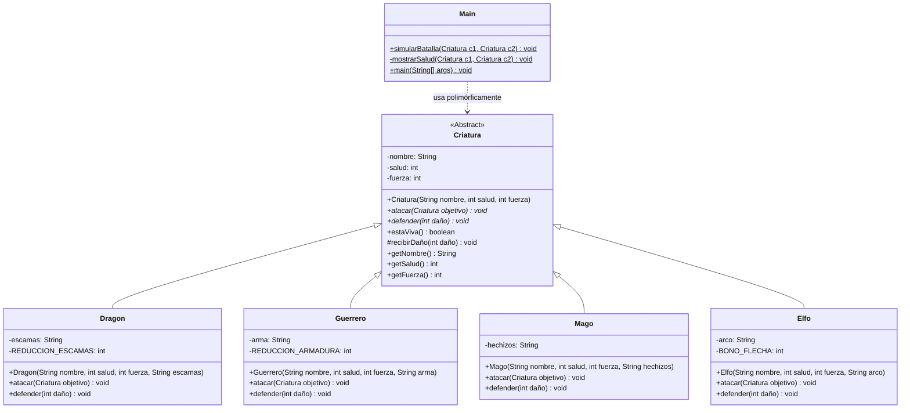

# Parcial II - Programación II (G412)

## ⚔️ Simulador de Batallas entre Criaturas

Proyecto desarrollado para el **Parcial II de Programación Orientada a Objetos II**, enfocado en la aplicación práctica de los principios de diseño orientado a objetos: **Abstracción**, **Herencia**, **Encapsulamiento** y **Polimorfismo**, gestionado y automatizado con **Apache Maven** y probado mediante **JUnit 5**.

---

## 👥 Integrantes del Equipo

- **Lauren Sofia Valderrama** ([@sofivalderrama06-sudo](https://github.com/sofivalderrama06-sudo))
- **Santiago Palma** ([@SantyPalma](https://github.com/SantyPalma))

---

## 🏛️ Principios de POO Implementados

1. **Abstracción**:
   - Clase abstracta base `Criatura` que define el contrato común para todas las entidades del juego.
   - Métodos abstractos `atacar(Criatura objetivo)` y `defender(int daño)`.

2. **Herencia**:
   - Subclases concretas (`Dragon`, `Guerrero`, `Mago`, `Elfo`) que extienden de `Criatura` y reutilizan la lógica base como el cálculo de vida y el control de supervivencia.

3. **Encapsulamiento**:
   - Atributos privados (`nombre`, `salud`, `fuerza`, atributos específicos de cada criatura) accesibles mediante getters.
   - El método protegido `recibirDaño(int daño)` controla la reducción de salud evitando que el valor caiga por debajo de 0.

4. **Polimorfismo**:
   - En la clase `Main`, el método `simularBatalla(Criatura c1, Criatura c2)` interactúa únicamente a través de la referencia abstracta `Criatura`, permitiendo que cualquier combinación de subclases combata sin necesidad de conocer su tipo concreto en tiempo de compilación.

---

## 🐉 Tipos de Criaturas y Reglas de Combate

| Criatura | Atributo Especial | Mecánica de Ataque | Mecánica de Defensa |
| :--- | :--- | :--- | :--- |
| **Dragón** | `escamas` (String) | **Llamarada**: Daño equivalente a `fuerza * 2`. | **Escamas**: Absorbe 3 puntos fijos de daño (`daño - 3`). Mínimo 1. |
| **Guerrero** | `arma` (String) | **Golpe de arma**: Daño equivalente a su `fuerza`. | **Armadura**: Bloquea 2 puntos de daño (`daño - 2`). Mínimo 1. |
| **Mago** | `hechizos` (String) | **Hechizo**: Daño equivalente a su `fuerza`. | **Escudo mágico**: Reduce el daño a la mitad (`daño / 2`). Mínimo 1. |
| **Elfo** | `arco` (String) | **Flecha certera**: Daño base `fuerza + 2` por bono de puntería. | **Agilidad y esquiva**: Recibe el 75% del daño (`daño * 3 / 4`). Mínimo 1. |

> [!NOTE]
> Todas las criaturas cuentan con una regla de defensa que garantiza recibir al menos **1 punto de daño** por ataque exitoso.

---

## 📐 Diagrama de Clases (UML)



---

## 📁 Estructura del Repositorio

```text
PARCIAL-2-412/
├── pom.xml                                   # Configuración de Maven y dependencias (JUnit 5)
├── README.md                                 # Documentación técnica del proyecto
├── .gitignore                                # Exclusión de artefactos compilados y carpetas target/
└── src/
    ├── main/java/com/parcial/
    │   ├── Criatura.java                     # Clase abstracta base
    │   ├── Dragon.java                       # Subclase: Ataque doble y reducción fija por escamas
    │   ├── Elfo.java                         # Subclase: Flechas certeras y evasión porcentual
    │   ├── Guerrero.java                     # Subclase: Ataque de arma y bloqueo con armadura
    │   ├── Mago.java                         # Subclase: Ataque mágico y reducción porcentual
    │   └── Main.java                         # Simulador de batallas por turnos y punto de entrada
    └── test/java/com/parcial/
        ├── CriaturaTest.java                 # Pruebas de vida mínima, getters y estado
        ├── DragonTest.java                   # Pruebas de daño doble y absorción
        ├── ElfoTest.java                     # Pruebas de bono de daño y esquiva
        ├── GuerreroTest.java                 # Pruebas de armadura y daño base
        ├── MagoTest.java                     # Pruebas de reducción al 50%
        └── MainTest.java                     # Pruebas de polimorfismo y simulación completa
```

---

## 🧪 Pruebas Unitarias (JUnit 5)

El proyecto incluye pruebas automatizadas exhaustivas que verifican:
- Estado inicial y condición de vida (`estaViva()`).
- Inmutabilidad de la vida por debajo de 0 (nunca toma valores negativos).
- Correcto cálculo de daños específicos para cada criatura:
  - Ataque duplicado del Dragón y absorción de 3 puntos.
  - Bono +2 del Elfo y recepción del 75% del daño.
  - Reducción al 50% por el escudo mágico del Mago.
  - Bloqueo de 2 puntos de la armadura del Guerrero.
  - Garantía del daño mínimo (1 punto).
- Verificación del polimorfismo mediante iteración sobre listas de tipo `Criatura`.
- Control de finalización de batallas (un único sobreviviente).

---

## 🚀 Compilación y Ejecución

### Opción 1: Con Apache Maven (Recomendado)

1. **Ejecutar las pruebas unitarias:**
   ```bash
   mvn test
   ```

2. **Compilar y empaquetar el proyecto:**
   ```bash
   mvn clean package
   ```

3. **Ejecutar la simulación principal:**
   ```bash
   mvn exec:java -Dexec.mainClass="com.parcial.Main"
   ```

### Opción 2: Compilación manual con `javac`

Desde la raíz de la carpeta `PARCIAL-2-412`:

```bash
# Compilar clases
javac -d target/classes src/main/java/com/parcial/*.java

# Ejecutar Main
java -cp target/classes com.parcial.Main
```

---

## 🔀 Flujo de Trabajo en Git

El desarrollo del proyecto se realizó de forma colaborativa a través de ramas por participante:
- `Santiago`: Implementación inicial y ajustes de `Dragon` y `Mago`.
- `Lauren`: Implementación de `Guerrero`, incorporación de `Elfo` y pruebas unitarias.
- Integración mediante Pull Requests a la rama `main` tras validación de código.
